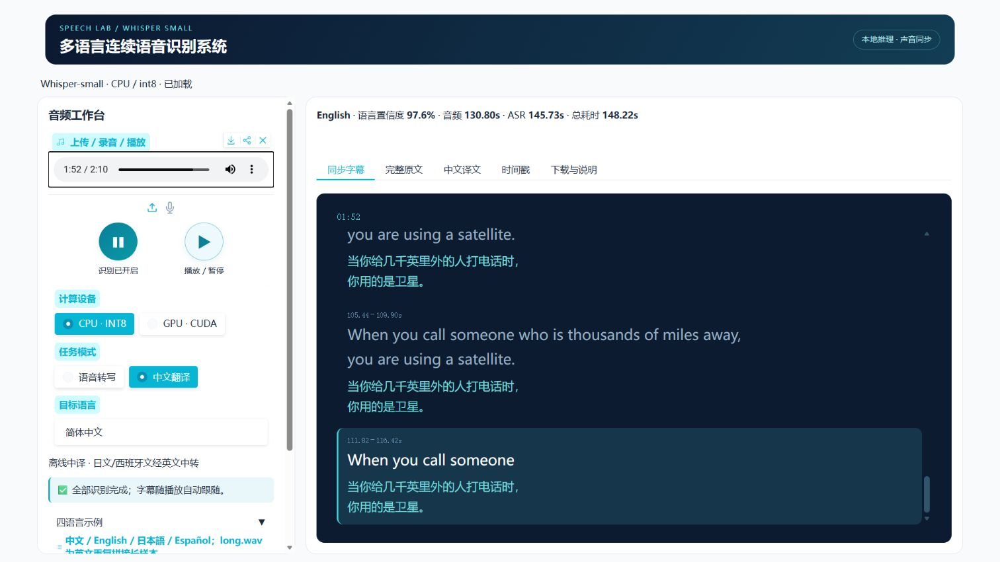

# 多语言连续语音识别系统

基于 **faster-whisper + Whisper-small + Gradio** 的本地语音识别课程项目。支持上传音频、浏览器录音、自动语言检测、原语言转写、离线中文翻译，以及跟随音频播放的动态字幕。

识别模型固定为多语言 **Whisper-small**，重点验证中文、英文、日文和西班牙文。音频与文本在本机处理，不需要付费 API 或 API Key。



## 功能

| 功能 | 说明 |
| --- | --- |
| 音频输入 | 上传 WAV、MP3、M4A 等音频，或录音结束后识别 |
| 自动检测语言 | 转写保留原语言；支持 Whisper-small 原有的多语言能力 |
| CPU / GPU | 页面选择 CPU INT8 或 NVIDIA CUDA；不支持所选精度时尝试 FLOAT32 |
| 中文翻译 | 英文直接译为中文，日文和西班牙文经英文中转；保留原文供对照 |
| 动态字幕 | 按播放时间显示文字，支持暂停、跳转、重播、高亮与自动滚动 |
| 长音频播放 | 首段字幕准备好后先播放，后续继续识别和翻译；字幕不足时自动缓冲 |
| 模式切换 | 处理完成后可直接切换转写 / 中文翻译，复用识别结果与译文缓存 |
| 结果导出 | 复制完整文本，下载 TXT、SRT 与含时间戳的 JSON |

> 这是“上传文件 / 录音结束后的分段识别与缓冲播放”，不是直播麦克风的实时识别。首次推理仍需等待，CPU 处理长音频时可能需要数十秒才出现首段字幕。约 3 秒的播放缓冲阈值不等于 3 秒的识别延迟。

## 快速开始：Windows + CPU

建议先用 CPU 跑通，不需要 NVIDIA 显卡。下面所有命令都在 **PowerShell、项目根目录** 执行；根目录应能看到 `gradio/app.py` 和 `requirements.txt`。

### 1. 获取项目并创建 Python 环境

在 GitHub 页面点击 **Code → Download ZIP**，解压后进入项目文件夹；也可复制本仓库的 HTTPS 地址，用 Git 克隆。请下载这个带有 `gradio/` 目录的课程项目，而不是仅安装上游 faster-whisper 包。

Web 依赖要求 **Python 3.10 或以上**，本项目实际验证环境为 **Windows x64 + Python 3.13.9**。推荐安装 64 位 Python 3.13，以下命令使用 Windows Python Launcher 的 `py -3.13`：

```powershell
py -3.13 --version
py -3.13 -m venv .venv-web
.\.venv-web\Scripts\python.exe -m pip install --upgrade pip
.\.venv-web\Scripts\python.exe -m pip install -r gradio/requirements.txt
```

如果没有 `py` 命令，但 `python --version` 显示的是准备使用的版本，可用 `python -m venv .venv-web` 创建环境。后续仍使用上述 `.venv-web` 内的解释器。

无需激活虚拟环境，也无需单独执行 `pip install faster-whisper` 或安装 PyTorch。入口会直接使用仓库内的 `faster_whisper/` 源码。请创建独立环境，不要使用 `--system-site-packages`，以免与已有 Anaconda / OpenMP 运行库冲突。

### 2. 准备 Whisper-small 权重（必需）

程序只读取项目中的 `model/small/`，不会在识别时自动下载 ASR 权重。首次使用请运行：

```powershell
.\.venv-web\Scripts\python.exe -c "from huggingface_hub import snapshot_download; snapshot_download(repo_id='Systran/faster-whisper-small', local_dir='model/small')"
```

下载来源为 [Systran/faster-whisper-small](https://huggingface.co/Systran/faster-whisper-small)，它是适用于 CTranslate2 的 Whisper-small 转换模型。权重文件约 484 MB，首次下载需要联网。已有完整本地模型时跳过本步骤，无需重新下载或转换。

下载后确认目录如下，文件应直接位于 `small/` 下，不要再嵌套一层文件夹：

```text
model/
└── small/
    ├── config.json
    ├── model.bin
    ├── tokenizer.json
    └── vocabulary.txt
```

请使用 **多语言 small**，不要替换为 `small.en`，也不要将 OpenAI 原始 `.pt` 权重直接放入此目录。网络不便时，可在其他电脑下载同一模型，再将整个目录复制到这里。

### 3. 准备离线中文翻译（可选）

如果需要页面中的“中文翻译”，再运行：

```powershell
.\.venv-web\Scripts\python.exe gradio/prepare_translation.py
```

脚本从 Argos 下载下列三个文本翻译包，已经存在的完整包会跳过。首次准备需要联网，准备完成后翻译在本地运行。

```text
model/
└── translation/
    ├── translate-en_zh-1_9/
    ├── translate-ja_en-1_1/
    └── translate-es_en-1_9/
```

每个包中应有 `model/model.bin`、分词文件及元数据。**只体验原语言转写时，可以暂时不下载翻译包。** 未准备翻译包就选择中文翻译时，页面会保留原文并提示缺少翻译包。

### 4. 启动网页

```powershell
$env:PYTHONUTF8 = '1'
.\.venv-web\Scripts\python.exe -u gradio/app.py
```

终端出现类似信息后，手动在浏览器打开该地址：

```text
Running on local URL: http://127.0.0.1:7860
```

默认从 7860 开始寻找可用端口；被占用时可能使用 7861、7862 等，**以本次终端打印的地址为准**。终端需要保持运行，按 `Ctrl+C` 停止服务。

以后再次使用，只需执行本节的启动命令，不用重复安装依赖或下载模型。也可运行 `./gradio/start.ps1`。

**启动 Web 系统不需要下载 FLEURS 数据集。** 可以直接上传自己的音频，或使用浏览器录音。四语言示例仅在对应本地数据存在时显示。

## 页面怎么使用

1. 首次体验选择 **CPU · INT8** 和 **语音转写**；需要中译时选择“中文翻译”。
2. 点击左侧圆形 **开始识别 ▶**，按钮变为双竖线，表示自动识别已持续开启。
3. 上传音频，或切到麦克风录音、停止录音。首次录音需允许浏览器访问麦克风。
4. 点击旁边的圆形 **播放 ▶**。系统准备前段字幕后从头播放，后面继续识别；缓冲不足时暂停等待，随后从原位置续播。
5. 字幕按句末标点与语音停顿分块，长句优先在自然位置换行。字幕自动跟随播放位置，可以暂停回看或拖动进度条。
6. 全部处理完成后，可切换“语音转写 / 中文翻译”，查看完整原文、中文译文、时间戳和下载结果。首次切到中译时只翻译已有原文，不重新识别音频。
7. 当前任务完成后更换音频，仍只需点击播放，**不必再次开启识别**。同一音频的暂停、继续、重播会复用结果。

处理中会锁定上传、示例、设备和任务模式，播放控制仍可使用。再次点击左侧识别键可关闭自动识别；已开始的后台推理仍会完成。刷新页面后识别开关恢复关闭。

翻译模式中，每个原文字幕块下方的中文译文会在对应语音区间内逐字显示。切分出的原文块会单独翻译。下载文件仍使用原始识别片段。关闭自动识别时，播放键仍可用于试听。

## NVIDIA GPU（可选）

先完成上述 CPU 安装，再安装匹配当前 CTranslate2 版本的 NVIDIA 驱动、CUDA 与 cuDNN。本项目验证环境使用 CTranslate2 4.9.0；faster-whisper 上游目前要求 CUDA 12 的 cuBLAS 与 cuDNN 9，具体配置参见 [官方 GPU 安装说明](https://github.com/SYSTRAN/faster-whisper#gpu)。仅安装 PyTorch 或只检测到显卡，不代表推理运行库已经配置齐全。

在项目环境中检查 CTranslate2 检测到的 CUDA 设备数：

```powershell
.\.venv-web\Scripts\python.exe -c "import ctranslate2; print(ctranslate2.get_cuda_device_count())"
```

完成运行库配置后，在页面选择 **GPU · CUDA** 即可，下一次新音频识别时切换设备，无需修改源码。GPU 优先 FLOAT16，CPU 优先 INT8；切换设备会释放旧 ASR 模型，同设备连续识别会复用模型。

本机开发环境没有可用 CUDA GPU，因此 GPU 实际推理和显存释放尚未实机验证。检测不到 CUDA 时页面会明确提示，请改用 CPU。

## Linux / macOS 启动方式

主验证平台是 Windows；Linux / macOS 可使用相同源码和模型目录，以下为对应命令，尚未在本项目中实机验收。macOS 在此页面中使用 CPU，GPU 选项指 NVIDIA CUDA。

```bash
# 使用 Python 3.10+，推荐与验证环境一致的 3.13
python3 -m venv .venv-web
.venv-web/bin/python -m pip install --upgrade pip
.venv-web/bin/python -m pip install -r gradio/requirements.txt
.venv-web/bin/python -c "from huggingface_hub import snapshot_download; snapshot_download(repo_id='Systran/faster-whisper-small', local_dir='model/small')"
# 需要中文翻译时执行
.venv-web/bin/python gradio/prepare_translation.py
PYTHONUTF8=1 .venv-web/bin/python -u gradio/app.py
```

`gradio/requirements.lock.txt` 是本机 Windows / Python 3.13 的依赖快照，不是跨平台通用锁文件。首次安装优先使用 `gradio/requirements.txt`。

## 目录说明

```text
.
├── gradio/
│   ├── app.py                   # Web 入口、交互与任务队列
│   ├── core.py                  # 模型复用、分段识别、文本翻译与导出
│   ├── assets/                  # 页面样式、音频控制、同步字幕
│   ├── subtitles/               # 字幕断句、换行与译文时间关联
│   ├── prepare_translation.py   # 离线翻译包下载工具
│   ├── requirements.txt         # Web 安装依赖，包含根目录核心依赖
│   ├── start.ps1                # Windows 启动脚本
│   ├── tests/                   # 推理、字幕、异常与 API 检查
│   └── TEST_REPORT.md           # 已完成的实测及验证边界
├── faster_whisper/             # 保留的上游识别核心库
├── experiments/                # 命令行转写、四语言评测、绘图
├── tests/                      # 核心库测试与测试音频
├── docs/                       # 界面截图与上游文档
├── model/                      # 本地权重，按安装步骤准备，不纳入 Git
├── datasets/                   # 可选本地 FLEURS 数据
├── requirements.txt            # 核心库依赖，单独安装不足以运行 Web
└── LICENSE
```

不要给本项目的 `gradio/` 添加 `__init__.py`，以免遮蔽第三方 Gradio 包。请按脚本方式运行 `gradio/app.py`。

## 常见问题

| 问题 | 处理方式 |
| --- | --- |
| `No module named gradio` 等缺包错误 | 使用 `.venv-web` 内的 Python，并执行 `-m pip install -r gradio/requirements.txt`；根目录依赖文件不包含全部 Web 依赖 |
| 提示缺少 `model.bin` / `tokenizer.json` | 按模型准备步骤下载，检查文件是否直接位于 `model/small/`，并确认没有拿到其他格式的权重 |
| 页面打不开或端口冲突 | 先查看终端是否仍在运行，打开实际打印的 URL；也可使用下方命令指定其他端口 |
| 点击开始识别后没有文字 | 左侧按钮是持续开启的识别开关；还需要上传 / 完成录音，并点击旁边的播放键 |
| 首次播放等待较久 | 首次加载模型、首个识别窗口和文本翻译都需要时间；长音频不保证低延迟，观察页面进度和缓冲提示 |
| 提示离线翻译包未安装 | 运行 `gradio/prepare_translation.py`；原语言转写不依赖翻译包 |
| 显示 CUDA 不可用或缺 CUDA/cuDNN DLL | 先切 CPU，再核对 GPU 运行库与 CTranslate2 版本；Windows 的一般 DLL 导入错误也可能需要 Visual C++ 运行库，参见 [CTranslate2 安装说明](https://opennmt.net/CTranslate2/installation.html) |
| 录音计时正常但听不到声音 | 先试听录音，核对操作系统输入设备、输入音量和浏览器权限；计时正常并不代表录到了有效声音 |
| 无法访问麦克风 | 使用本机 `http://127.0.0.1` / `http://localhost` 或 HTTPS，并允许麦克风权限；通过其他设备的普通 HTTP 地址访问可能受限 |
| 出现 OpenMP 重复加载错误 | 使用新建的独立虚拟环境，避免混用 Anaconda / 系统包，不通过屏蔽错误来处理冲突 |

指定端口的例子：

```powershell
.\.venv-web\Scripts\python.exe -u gradio/app.py --port 7861
```

默认仅监听本机 `127.0.0.1`，没有开启公网分享。启动后显示“未加载”是正常状态，首次识别时才加载本地模型。

## 可选：四语言实验与测试

这些步骤用于复现实验，不是启动网页的前置条件。

### 命令行转写与评测

```powershell
# 使用本地 small 模型识别仓库中的测试音频
.\.venv-web\Scripts\python.exe experiments/transcribe.py

# 查看评测参数；正式评测需要准备 FLEURS 数据
.\.venv-web\Scripts\python.exe experiments/evaluate.py --help
.\.venv-web\Scripts\python.exe experiments/evaluate.py --split dev --samples 10 --seed 2024

# 绘图的可选依赖，仅绘图时需要安装
.\.venv-web\Scripts\python.exe -m pip install matplotlib
.\.venv-web\Scripts\python.exe experiments/plot.py --list
.\.venv-web\Scripts\python.exe experiments/plot.py
```

评测使用 [Google FLEURS](https://huggingface.co/datasets/google/fleurs)，四语言目录分别为 `cmn_hans_cn`、`en_us`、`ja_jp`、`es_419`。现有脚本读取原始 TSV 清单及 WAV 文件，目录示例：

```text
datasets/data/en_us/
├── dev.tsv
├── test.tsv
└── audio/
    ├── dev/*.wav
    └── test/*.wav
```

其他语言按相同结构放置。仅下载新版 Parquet 文件并不能直接供此评测脚本使用。实验结果保存在 `experiments/output/`；评测中文繁简归一可另安装 `opencc-python-reimplemented` 并传入 `--zh-simplify`。

### Web 检查

四语言推理测试需要上述数据，模式与 API 测试需要对应英文样本；仅检查静音和异常不需要完整 FLEURS。JS 检查需要另外安装 Node.js，它不是运行 Web 系统的必要依赖。

```powershell
.\.venv-web\Scripts\python.exe gradio/tests/web_smoke.py
.\.venv-web\Scripts\python.exe gradio/tests/web_errors.py
.\.venv-web\Scripts\python.exe gradio/tests/web_modes.py
.\.venv-web\Scripts\python.exe gradio/tests/web_transport.py
.\.venv-web\Scripts\python.exe gradio/tests/web_sentences.py
node gradio/tests/web_sync.cjs
node gradio/tests/web_transport.cjs
```

本机已验证四语言 CPU 识别、中译、模式缓存切换、字幕滚动与缓冲播放。130.8 秒英文重复样本的一轮测试中，首个可播放缓冲约 40.94 秒、全部处理约 135.85 秒；这不是通用速度承诺或自然长语音质量评测。完整记录见 [实际测试报告](gradio/TEST_REPORT.md)，内部实现细节见 [Gradio 说明](gradio/README.md)。

## 限制与许可

- 单段音频限制为 30 分钟，建议演示使用几分钟以内音频。解码后的音频保存在内存中。
- 中文 / 日文原文的字符时间来自模型词时间戳插值。中文译文的显字时间根据对应语音区间估算。
- 中文翻译当前只覆盖中文、英文、日文和西班牙文；中文输入保留原文。其他语种仍可尝试转写，但中译会提示不支持。
- 离线翻译可能存在专有名词和语义错误，日文 / 西班牙文中转会增加误差。语音识别也可能漏字或漏段，语言置信度不是转写准确率。
- 下载结果使用系统临时目录，服务重启后不保证旧链接有效，请及时保存。
- 安装与模型准备需要网络；依赖及权重准备完整后，本地识别和翻译不需要外部 API。

本仓库保留上游 [faster-whisper](https://github.com/SYSTRAN/faster-whisper) 的 MIT 许可与版权声明，见 [LICENSE](LICENSE)。Whisper-small、Argos 翻译模型与 FLEURS 数据分别遵循各自的许可；FLEURS 的许可说明见其 [数据集页面](https://huggingface.co/datasets/google/fleurs)。重新分发模型或音频时请同时保留对应说明。
